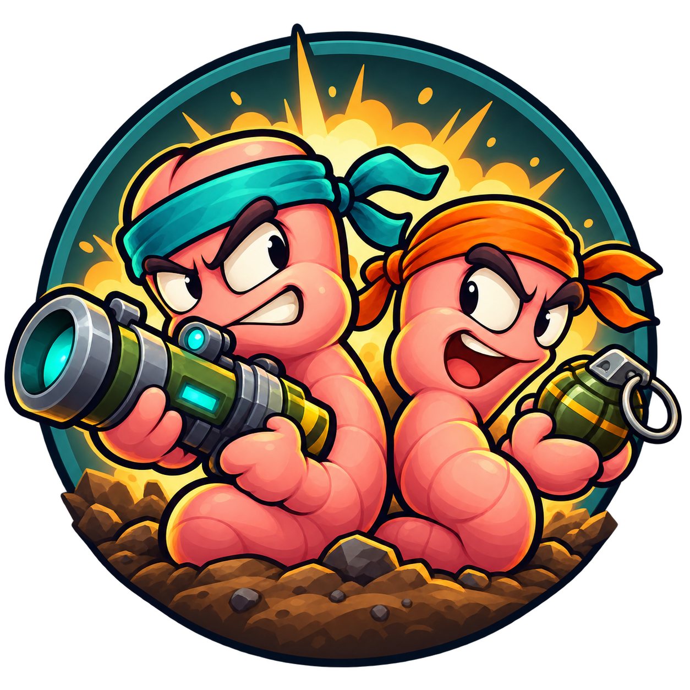
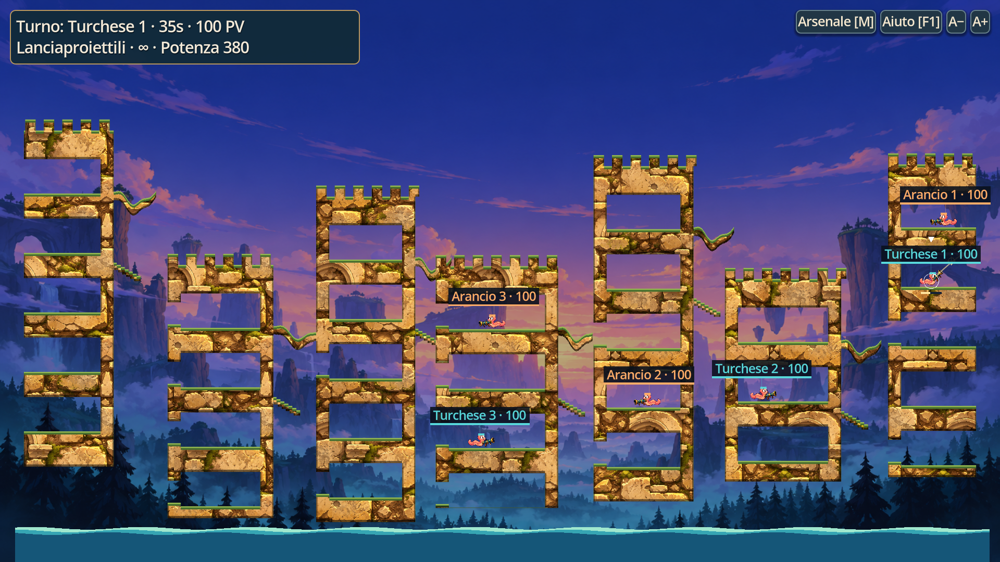
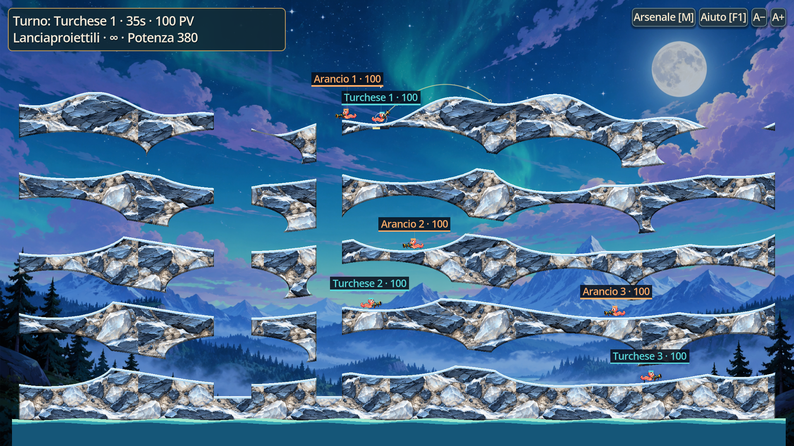

# Wormfront



**Gioco di artiglieria 2D a turni per Windows, di SboMusic.**
Versione: **0.20.0** · Godot **4.5.1 Standard** · GDScript.

**[SCARICA IL GIOCO PER WINDOWS (ZIP di installazione)](https://github.com/SboMusic/Wormfront/releases/download/v0.20.0/Wormfront-0.20.0-Windows-Setup.zip)**

Estrai tutto lo ZIP e apri `Installa.cmd`. Il pulsante verde **Code > Download ZIP**
scarica i **sorgenti per sviluppatori**, che non contengono il gioco compilato.
La cartella `installer/` dei sorgenti serve a costruire le distribuzioni.



Due squadre di vermi, terreno distruttibile, 36 armi, IA a tre difficolta,
mappe procedurali ed editor integrati. Progetto gratuito per gli usi non
commerciali consentiti dalla [licenza](LICENSE). Sorgenti consultabili e
modificabili: non e una licenza open source senza restrizioni commerciali.

## Giocare

Dalla sezione **Releases** scarica uno di questi pacchetti:

- **[Wormfront-0.20.0-Windows-Setup.zip](https://github.com/SboMusic/Wormfront/releases/download/v0.20.0/Wormfront-0.20.0-Windows-Setup.zip)**: estrai tutto e apri `Installa.cmd`.
  Installa per il solo utente Windows, senza diritti di amministratore,
  e aggiunge il collegamento nel menu Start sotto SboMusic.
- **Wormfront-0.20.0-Windows-x64.zip**: versione portatile. Estrai tutta la
  cartella e apri `Wormfront.exe`, mantenendo accanto `Wormfront.pck`.

Non occorre installare Godot per giocare. Le distribuzioni non includono
salvataggi dell'autore, credenziali o configurazioni personali.

## Cosa contiene

- Squadre da 1 a 4 personaggi, timer, salute, danni agli alleati configurabili.
- 36 armi/varianti: granate, raggi, fucili, trivelle, bomba sacra, missili
  guidati e telecomandati, grappoli, incursioni, dinamite e corpo a corpo.
- Teletrasporto, casse di salute e munizioni condivise dalla squadra.
- 24 scelte di terreno, semi casuali e partenze mescolate su appoggi validi.
- Cittadelle con stanze, camere cavernose, falesie, tunnel e archi;
  superfici di muratura, ghiaccio e roccia vulcanica.
- Tre sfondi casuali all'avvio, testi regolabili e camera ferma durante il tiro.
- Editor di mappe, armi e regole; file e pacchetti condivisibili.



## Comandi essenziali

| Comando | Azione |
| --- | --- |
| Mouse | Mira |
| Sinistro tenuto, poi rilasciato | Carica e spara |
| Destro trascinato | Regola la potenza |
| A/D o frecce; Shift | Movimento; salto |
| M / Tab | Arsenale |
| Rotella; C; trascina rotella | Zoom; panoramica; sposta visuale |
| F1; Esc; F11 | Aiuto; pausa; schermo/finestra |
| F2; F4 | Editor mappe; editor armi e regole |

La [guida utente](docs/GUIDA_UTENTE.md) spiega tutte le armi speciali e i salvataggi.

## Modificare e compilare

1. Installa Godot **4.5.1 Standard** (non serve .NET).
2. Importa `project.godot` e avvia con F6/F5 secondo la scena/progetto nell'editor.
3. Per cambiare le armi modifica `data/weapons.json`, poi riavvia il progetto.
4. Leggi [MODDING](docs/MODDING.md) prima di aggiungere meccaniche o cambiare i formati.
5. Per creare la distribuzione Windows segui [BUILD](docs/BUILD.md).

```text
src/         codice diviso per responsabilita
assets/      immagini, materiali, icone e note grafiche
 data/       definizioni delle armi
 tests/      prove automatiche e strumenti visivi
 tools/      compilazione, test, esportazione e pacchetti
 installer/  installazione e disinstallazione per utente
 docs/       guide, architettura, cronologia e screenshot
 licenses/   termini e attribuzioni dei componenti di terze parti
```

## Documentazione

- [Guida utente](docs/GUIDA_UTENTE.md)
- [Modifiche e personalizzazioni](docs/MODDING.md)
- [Architettura e funzionamento](docs/ARCHITETTURA.md)
- [Come e stato sviluppato](docs/SVILUPPO.md)
- [Compilazione e distribuzione](docs/BUILD.md)
- [Test e verifica della release](docs/TEST.md)
- [Pulizia dei dati personali](docs/PRIVACY.md)
- [Cronologia](docs/CHANGELOG.md) e [lavoro rimanente](docs/ROADMAP.md)
- [Come contribuire](CONTRIBUTING.md)

## Stato e limiti

Alpha giocabile, non prodotto definitivo: bilanciamento e animazioni da
rifinire. Nessuna modalita online. Le 36 voci non comprendono tutte le armi
di Worms. L'IA usa il pianificatore balistico e delle armi istantanee;
non pianifica ancora telecomando, teletrasporto, incursioni e corpo a corpo.
La grafica usa immagini originali realizzate anche con assistenza AI.

Wormfront e indipendente e non e affiliato a Team17. Il riferimento alle
meccaniche di altri giochi non implica condivisione dei loro asset o marchi.

**Autore: SboMusic.** [Licenza non commerciale](LICENSE).
Godot e le sue dipendenze conservano le [licenze originali](licenses/).


